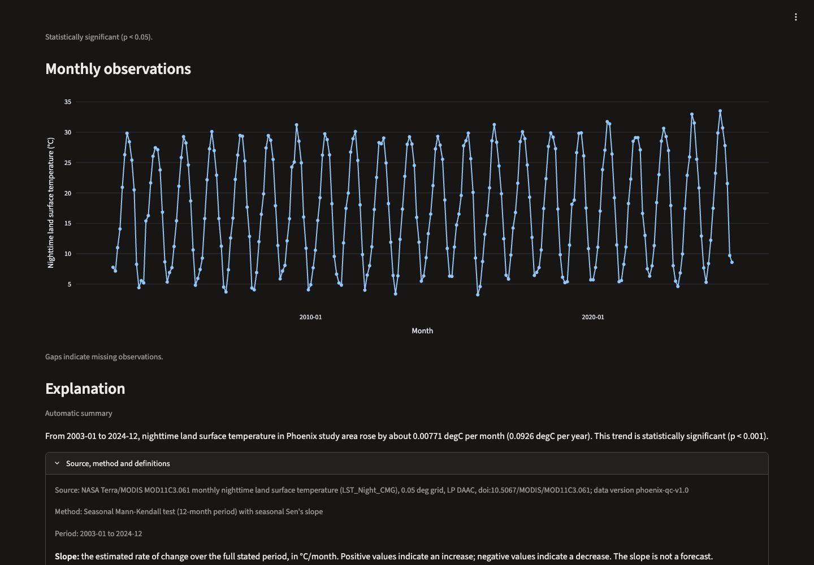
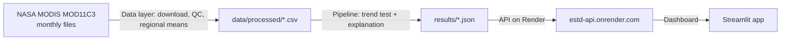

# Earth System Trend Detective

NASA Space Apps Challenge 2026 · *Be an Earth System Trend Detective!*

## What it does

Pick a part of **Phoenix, Arizona** and see how its **nighttime land surface temperature**
changed every month from **2003 to 2024**, measured by NASA's Terra/MODIS satellite.
The tool tests whether the change is a real trend (seasonal Mann-Kendall test), says how fast
it is, and explains the result in plain language using only the computed numbers.

Result on the real data: every part of the Phoenix study area shows a statistically significant
warming trend (p < 0.001), from about +0.06 °C per year (northeast) to +0.11 °C per year
(southeast). The plain trend test misses this because the summer/winter swing hides it.

Scope: the demo covers Phoenix. Extending to the whole United States is a stretch goal.

**Live dashboard:** [estd-frontend.onrender.com](https://estd-frontend.onrender.com)

**Live API:** https://estd-api.onrender.com · interactive docs at
https://estd-api.onrender.com/docs

## Quick start

Needs Python 3.12 and [uv](https://docs.astral.sh/uv/).

```
git clone https://github.com/thejeffhunter21/nasaspaceapps-ESTD.git
cd nasaspaceapps-ESTD
uv sync --locked
uv run --locked streamlit run app/streamlit_app.py
```

The dashboard opens at http://localhost:8501 and reads the live API. To run the API on your
own machine instead, start it in a separate terminal:

```
uv run --locked uvicorn earth_system_trend.api.app:app --reload
```

Then open http://localhost:8000/docs. It serves mock data unless `USE_MOCK=false`
(see [Settings](#settings)). To point the dashboard at that local API, start Streamlit with:

```sh
API_URL=http://127.0.0.1:8000 uv run --locked streamlit run app/streamlit_app.py
```

For a synthetic preview without API requests, use `API_URL=` instead. The preview
shows **Offline preview** and **Sample data**; it is not the real-data offline backup.
The dashboard's Python server calls the API, so this setup requires no backend
browser-origin CORS changes.

Frontend-only installation, port changes, settings and recovery steps are in the
[tested frontend runbook](docs/frontend_runbook.md). See the
[freeze checklist and known limits](docs/frontend_demo_freeze.md) before presenting.
Native Chrome/Safari desktop core interactions were subsequently checked; native
phone and full screen-reader acceptance remain partial/pending.

For the approved real snapshot without an API, use the
[FE-14 offline package and rehearsal instructions](docs/frontend_offline.md).
The Apple silicon bundle includes dependency wheels; it needs preinstalled
Python 3.12 and macOS 14+. From its extracted folder, run
`sh START_OFFLINE.command --check`, then `sh START_OFFLINE.command` and open
http://127.0.0.1:8501. The page labels **Offline snapshot** and verifies all five
approved result files before showing evidence. Two physical Wi-Fi-off laptop
rehearsals and saved-clip playback remain pending.

### Dashboard preview

Real Phoenix study-area observations and supplied explanation/source, captured
from the FE-12 release (the runtime is unchanged in FE-13):



[Desktop overview](docs/evidence/frontend/fe12_desktop.jpg) ·
[Phone cards](docs/evidence/frontend/fe12_phone_cards.jpg) ·
[Phone chart](docs/evidence/frontend/fe12_phone_chart.jpg)

## How it fits together



1. The Data layer downloads and quality-checks the NASA files ([data card](docs/data_card.md)).
2. It writes one monthly series per region to `data/processed/*.csv` (`date,value`; a blank
   value is a missing month).
3. The pipeline runs the trend test, adds the explanation and writes `results/*.json`, checked
   against the [results contract](docs/contract.md).
4. The API serves those files from Render.
5. The dashboard calls the API and draws the charts.

| Layer | Folder | Owner |
|---|---|---|
| Data | `data/processed/`, `docs/data_card.md` | Data team |
| Trend test + explanations | `src/earth_system_trend/ai/` ([details](docs/ai.md)) | AI team |
| Pipeline, API, deploy | `src/earth_system_trend/pipeline/`, `api/`, `contract.py` | Backend |
| Dashboard | `app/` | Frontend team |

If you need to change a file you don't own, say so in chat first.

## Build the results

One command rebuilds every results file from the CSVs:

```
uv run --locked python -m earth_system_trend.pipeline.run --all-regions --force
```

| Flag | Meaning |
|---|---|
| `--all-regions` | Also build each sub-region listed in `data/processed/regions.json` |
| `--force` | Rebuild even if the results are newer than the CSVs |
| `--stub` | Write a fake CSV first if none exists (for testing without data) |
| `--csv`, `--out` | Other input / output paths |

Without a Gemini key every explanation is the automatic summary
(`explanation_source: "fallback"`). With `GEMINI_API_KEY` and `GEMINI_MODEL` in `.env`, checked
AI text is used (`"ai"`). Missing months stay `null`; they are never filled in. If the Data
layer's `anomaly*.csv` and `climatology.csv` are in `data/processed/`, each results file also
gets the region's anomaly series and baseline.

## API

All endpoints are GET and return JSON. Full reference: [docs/api.md](docs/api.md).

| Endpoint | Gives |
|---|---|
| `/regions` | Every region with its id, label and trend |
| `/series?region=<id>` | The monthly values for the chart |
| `/anomaly?region=<id>` | The same months as the difference from each calendar month's 2003-2024 average |
| `/trend?region=<id>` | Trend numbers, explanation, source and method |
| `/results` | The whole results file for the study area |
| `/demo` | Three ready-made demo stories |
| `/health`, `/version` | Is it up, and which commit is live |

## Settings

Set in `.env` locally (copy `.env.example`) or in Render's dashboard. Never commit `.env`.

| Variable | Default | Meaning |
|---|---|---|
| `USE_MOCK` | `true` | `true` serves `results.mock.json`; `false` serves the real `results/` files |
| `RESULTS_PATH` | depends on `USE_MOCK` | The file `/results` serves |
| `REGIONS_DIR` | `results/regions` | Folder of sub-region results |
| `CORS_ORIGINS` | `http://localhost:8501` | Comma-separated sites allowed to call the API; `*` for any |
| `REQUEST_TIMEOUT_S` | `10` | Longer requests get 504 |
| `RATE_LIMIT_PER_MINUTE` | `60` | Requests per visitor per minute; `0` turns it off |
| `GEMINI_API_KEY`, `GEMINI_MODEL` | empty | AI explanations when building results (pipeline only) |
| `API_URL` | `https://estd-api.onrender.com` | Which API the dashboard reads |

## Deploy

The API runs on Render (free tier) from the `Dockerfile`:

```
docker build -t estd-api .
docker run -p 8000:8000 -e USE_MOCK=false estd-api
```

- Render: Docker runtime, health check `/health`, `USE_MOCK=false`.
- Every merge to `main` runs `.github/workflows/deploy.yml`: tests, then Render's deploy hook
  (secret `RENDER_DEPLOY_HOOK`), then it waits until `/version` shows the new commit and runs
  the smoke test. Without the secret, deploy by hand in Render: Manual Deploy, Deploy latest
  commit.
- `.github/workflows/uptime.yml` checks `/health` every 10 minutes, which also keeps the free
  service awake. The first request after a quiet spell can still take about 50 seconds.

## Tests

```
uv run --locked pytest                       # everything (about 30 s)
uv run --locked pytest -m unit               # fast tests only
uv run --locked pytest -m integration        # pipeline -> real API server, end to end
uv run --locked python scripts/smoke_test.py --expect-real   # check the live API
```

Tests never call NASA, OpenAI or Gemini. CI runs ruff, pytest and a Docker build on every PR.

## Backup run

If the wifi or Render fails during the demo, run everything on one laptop:

```
uv run --locked python scripts/backup_run.py
```

It starts the API from the committed `results/` files, checks it is serving real data, then
opens the dashboard pointed at it. No internet is needed. Ctrl+C stops it.

## Data and credits

- **Data:** NASA Terra/MODIS MOD11C3 Collection 6.1, monthly land surface temperature
  (`LST_Night_CMG`), 0.05° grid. Wan, Z., Hook, S., Hulley, G. (2021), distributed by NASA EOSDIS
  Land Processes DAAC. https://doi.org/10.5067/MODIS/MOD11C3.061
- **Study area:** a fixed rectangle around Phoenix (west -112.4, south 33.2, east -111.6,
  north 33.8), split into four sub-regions. It is a study window, not the city boundary.
  Data version `phoenix-qc-v1.0`. Details: [data card](docs/data_card.md),
  [quality report](docs/data_quality_report.md).
- **Method:** seasonal Mann-Kendall test with seasonal Sen's slope (`pymannkendall`).
  Details and limits: [docs/ai.md](docs/ai.md).
- **AI use:** AI tools helped write code and documentation. Explanations shown in the app are
  either an automatic summary built from the numbers or Gemini text that passed automated
  number checks; the label in each answer says which.
- **Libraries:** FastAPI, pandas, pydantic, pymannkendall, statsmodels, Streamlit, Plotly.
